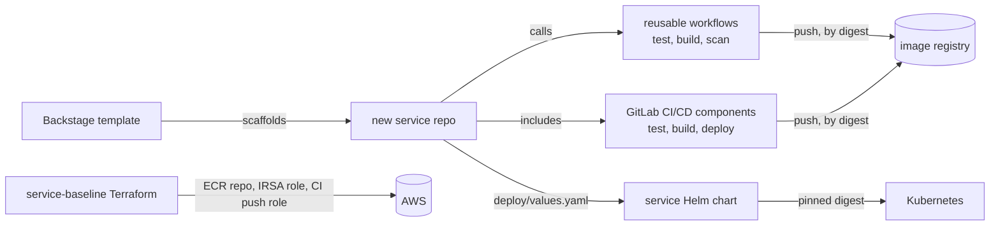

# golden-path

A paved road for shipping Go services on Kubernetes: one Backstage template that creates a service with CI, a hardened image, a secure Helm deployment and its AWS baseline already wired together. Teams start production-ready on day one, and the platform team upgrades everyone by releasing a new version.

[](https://github.com/sethbergman/golden-path/actions/workflows/ci.yml)

## What a team gets



| Piece | Path | What it gives a service |
|---|---|---|
| **Backstage template** | [`backstage/`](backstage/) | A new repo in one form: code, CI for GitHub and GitLab, deploy values, catalog entry with an owner. |
| **Reusable workflows** | [`.github/workflows/reusable-*.yml`](.github/workflows/) | Go tests with the race detector; image build with SBOM and provenance, a vulnerability gate, and the pushed digest as an output. |
| **GitLab CI/CD components** | [`templates/`](templates/) | The same pipeline on GitLab: test, rootless BuildKit build (no Docker-in-Docker, no privileged pods), and a Helm deploy through the GitLab agent. |
| **Image** | [`docker/go/Dockerfile`](docker/go/Dockerfile) | Static binary on distroless, non-root, version stamped, cached module downloads. |
| **Helm chart** | [`charts/service/`](charts/service/) | Non-root, read-only filesystem, all capabilities dropped, probes, HPA, PDB, zone spreading, NetworkPolicy, optional ServiceMonitor. A values schema rejects `latest` tags, single-replica autoscaling, public load balancers and missing owners. |
| **AWS baseline** | [`terraform/modules/service-baseline/`](terraform/modules/service-baseline/) | ECR repository with immutable tags, scan on push and expiry; a workload role for the pods (IRSA); and a GitHub Actions OIDC role that can push only from `main` or a version tag. |
| **Example** | [`examples/hello-service/`](examples/hello-service/) | A real service built on all of the above, and tested by this repo's CI on every push. |

## How it is tested

The golden path is only worth following if it works, so CI exercises it the way a team would:

- **hello-service** runs through the reusable workflows themselves: tests, image build, vulnerability scan, and a push to GHCR from `main`.
- **The chart** is linted, rendered and validated against Kubernetes schemas, and CI confirms it *rejects* unsafe values: no owner, no image, `latest`, a single autoscaled replica, or a `LoadBalancer`.
- **The Backstage template** is rendered the way Backstage renders it (`scripts/render-skeleton.py`), and the generated service must build, pass its tests, render through the chart, and build as an image. Any placeholder left unrendered fails the build.
- **GitLab components** are checked for the component structure; **Terraform** is formatted and validated; workflows pass **actionlint**; **Checkov** scans the IaC, Dockerfile, workflows and chart.

## Using it

**New service:** register `backstage/template.yaml` in your Backstage instance, then choose *Go service (golden path)* under Create.

**Existing service on GitHub:**

```yaml
jobs:
  test:
    uses: sethbergman/golden-path/.github/workflows/reusable-go.yml@v1
  image:
    needs: test
    permissions: { contents: read, packages: write }
    uses: sethbergman/golden-path/.github/workflows/reusable-container.yml@v1
    with:
      context: .
      dockerfile: Dockerfile
      image: my-service
      push: ${{ github.ref == 'refs/heads/main' }}
```

**Existing service on GitLab** (with this repo mirrored as a CI/CD catalog project):

```yaml
include:
  - component: $CI_SERVER_FQDN/platform/golden-path/go@1.0.0
  - component: $CI_SERVER_FQDN/platform/golden-path/container@1.0.0
```

More: [adopting the golden path](docs/adopting.md) · [versioning and upgrades](docs/versioning.md) · [decision records](docs/decisions/)

## Try it locally

```bash
make test        # example service: vet + race-checked tests
make skeleton    # render the Backstage template and test the generated service
make image       # build hello-service with the golden-path Dockerfile
make chart       # helm lint + template (needs helm)
```

## Status

- Checked on every push: everything under "How it is tested".
- Not covered: a live Backstage instance running the template (the render script mirrors `fetch:template`'s substitution), GitLab pipelines (the components are validated structurally here), and a `terraform apply`.
- Consumers pin `@v1` / `@1.0.0`. Tag a release after the first green build so those references resolve.

## License

MIT
